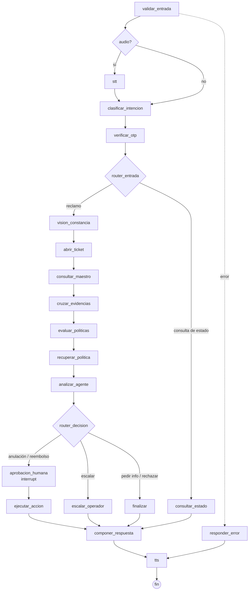

# Arquitectura

## 1. Principio: Percepción ≠ Dato maestro ≠ Inferencia ≠ Acción

| Categoría | Qué es en este sistema | Dónde vive | Confianza |
|---|---|---|---|
| **Percepción** | Transcripción del audio (STT), campos leídos de la imagen (visión), relato del cliente | `proveedores/`, nodos `stt` y `vision_constancia` | Falible: se valida y se contrasta |
| **Dato maestro** | Cliente, tarjeta, transacción, balance, ticket (Azure SQL) | `mcp_server/tools.py` → SQL | **Autoridad máxima** (BD > imagen > relato) |
| **Inferencia** | Tipo de reclamo, confianza, explicación, acción *propuesta* | `agente/agente.py` (LLM con salida JSON validada) | Sugerencia, nunca orden |
| **Acción** | Anular, reembolsar, escalar, cerrar | tools de acción + HITL | Solo con aprobación humana verificada en BD |

Consecuencias de diseño: el motor determinista `politicas/motor.py` decide; el agente solo puede *coincidir* o *volverse más conservador*
(escalar si discrepa o su confianza < 0.6). Los montos/fechas que se dicen por audio salen de plantillas con datos de la BD, no del LLM.

## 2. Vista general

```mermaid
flowchart LR
  U[Cliente: audio + constancia] --> API[FastAPI /api/v1/reclamos]
  API --> SVC[ProcesadorReclamos]
  SVC --> G[Grafo LangGraph]
  G <--> CK[(Azure SQL<br/>checkpoints)]
  G --> PRV[ProveedorIA<br/>Azure OpenAI]
  G --> MCP[Cliente MCP]
  MCP --> SRV[Servidor MCP<br/>tools tipadas] --> DB[(Azure SQL<br/>dato maestro)]
  G --> RAG[Qdrant<br/>políticas P-01..P-11]
  G -. interrupt .-> HITL[Analista: aprobar / rechazar]
  HITL --> API2[/aprobaciones/{id}/decision/] --> SVC
  G --> TTS[TTS] --> A[Respuesta solo en audio]
  G -.-> OTEL[OpenTelemetry<br/>trazas, métricas, logs]
```

## 3. Flujo del grafo (`orquestador/grafo.py`)



El OTP se verifica **antes** de la visión: no se gasta cómputo ni se expone nada a un usuario no autenticado.

### Señal de fraude: operación con / sin OTP (P-11)

`Transaccion.autenticada_otp` (changeSet `009`) es **dato maestro**: indica si la operación original se confirmó con el OTP del cliente. No es el OTP del formulario (ese autentica a quien reclama; ver `seguridad/otp.py`).
Cuando el cliente **desconoce** una operación (`SIN_CONSENTIMIENTO`), `politicas/motor.py` decide:

| `autenticada_otp` | Decisión | Motivo |
|---|---|---|
| `1` (con OTP) | `ESCALAR_OPERADOR` (P-11), sin acción monetaria | Posible ingeniería social o código compartido: lo verifica un humano |
| `0` (sin OTP) | Flujo normal: `ANULACION` / `REEMBOLSO` con aprobación humana (P-01 / P-03) | Indicio fuerte de fraude |

Datos de prueba: `db/datos_prueba_fraude_otp.sql` (`python scripts/cargar_datos_fraude.py`) y los tipos de escenario `SIN_CONSENTIMIENTO` (sin OTP) y `SIN_CONSENTIMIENTO_CON_OTP` (con OTP).

## 4. Las nueve capas

| # | Capa | Implementación |
|---|---|---|
| 1 | Entrada multimodal | `api/app.py` (multipart), `modalidades/validacion_archivos.py` (magic bytes, tamaño, rechazo de video) |
| 2 | Percepción | `ProveedorIA.transcribir` / `extraer_constancia` (Whisper, visión) |
| 3 | Validación | `validadores/constancia.py` (formato oficial, soles/USD, 4–5 dígitos finales) |
| 4 | Dato maestro | `mcp_server/tools.py` (14 tools con envoltorio `{ok, data|error}`) |
| 5 | Conocimiento | `rag/` (Qdrant; políticas versionadas; recuperación obligatoria de P-xx del motor) |
| 6 | Razonamiento | `agente/` (prompts versionados, JSON validado con Pydantic) + `politicas/motor.py` |
| 7 | Acción y HITL | `hitl/aprobacion.py`, nodo `aprobacion_humana` (`interrupt`), tools protegidas |
| 8 | Memoria | `memoria/sqlserver_saver.py` (checkpointer en SQL), `thread_id = sesion_id`, resumen entre turnos |
| 9 | Observabilidad y salida | `observabilidad/otel.py`, TTS-only (`orquestador/respuestas.py`) |

## 5. Decisiones y alternativas relevantes

| Tema | Elegido | Alternativas descartadas |
|---|---|---|
| Quién decide dinero | Motor de reglas + HITL; LLM infiere | LLM autónomo (no reproducible ni auditable) |
| Acceso a datos | MCP con tools tipadas | SQL generado por el LLM (riesgo de inyección y fuga) |
| Checkpointer | `SqlServerSaver` propio sobre pyodbc | `langgraph-checkpoint-mssql` (exige Python ≥ 3.12); `MemorySaver` (no sobrevive reinicios) |
| Audio | STT previo (se registra y valida) | Audio directo al LLM (pierde trazabilidad) |
| Proveedor IA | Interfaz `ProveedorIA` (Azure / mock) | Llamadas directas al SDK desde los nodos |
| Esquema | Liquibase YAML + SQL | Scripts sueltos sin control de versión |

## 6. Idempotencia, concurrencia y recuperación

- Ticket: `ticket_id = TKT-` + sha256(`Idempotency-Key` o `sesion|operación`)[:10]; la misma clave devuelve el mismo ticket.
- Una sola acción por reclamo (P-05): `UPDATE … WHERE accion_ejecutada IS NULL`; el reintento de la misma acción es idempotente.
- HITL: `resolver_aprobacion` es atómico (solo pasa si sigue `PENDIENTE` y no venció); el grafo se reanuda desde el checkpoint con `Command(resume=…)`,
  incluso desde **otro proceso** (probado en `tests/test_persistencia_herramientas.py`).
- Errores: imagen inválida → `PEDIR_INFO` (degradación); fallo técnico → `ERROR_TECNICO` + ticket `PENDIENTE_TECNICO`; tools con un reintento si el error es reintentable.

## 7. Límites conocidos

- Autenticación real (el OTP es de demostración), antifraude y detección de comprobantes falsificados no están implementados.
- Constancia solo en imagen (PNG/JPG); sin PDF ni multi-idioma.
- Qdrant en modo local admite un solo proceso; para producción use `QDRANT_URL` (Qdrant Cloud) y `QDRANT_API_KEY`.
- `pytest` fuerza Qdrant local (`.qdrant_test/`) y SQL simulado: los embeddings *mock* (256 dim) no deben tocar una colección real indexada con embeddings de 1536 dim.
- El runner Liquibase en Docker no se pudo ejecutar en el entorno de desarrollo (sin Docker/Java): el esquema se validó con `scripts/aplicar_esquema.py` sobre el mismo changelog.
- La ruta Azure OpenAI (`proveedores/azure_openai.py`) requiere credenciales reales; **no se ejecutó** en este entorno (las pruebas usan el proveedor *mock*).
